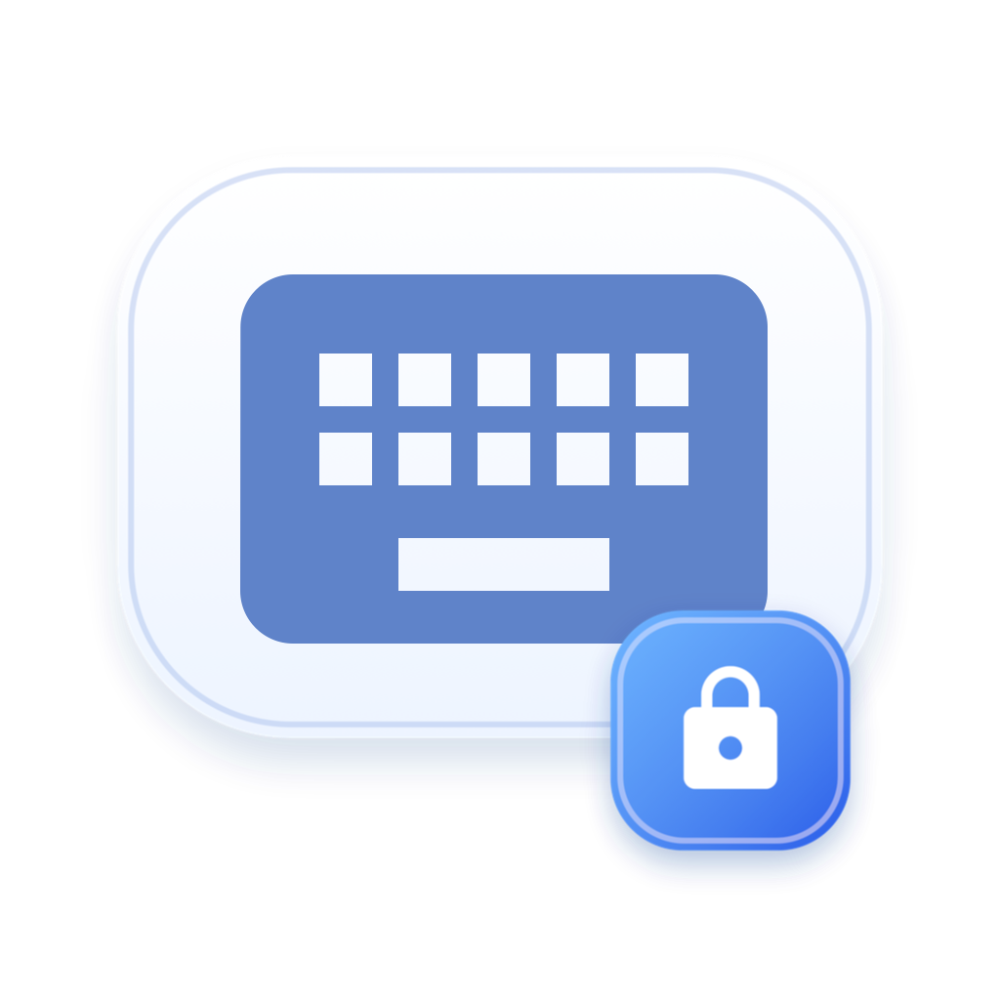

<div align="center">



# 输入法锁定

**让 Mac 留在你想用的输入法。**

切换应用后，输入法又变成了 ABC？
输入法锁定会自动尝试切回你选定的输入法，让你少一次手动切换。

**[⬇️ 下载最新版](https://github.com/FOREST227/IMELocker/releases/latest)** · **[📋 更新记录](docs/releases/)** · **[💬 反馈问题](https://github.com/FOREST227/IMELocker/issues)**

macOS 12 及以上 · 支持 Apple Silicon 与 Intel · 菜单栏小工具

</div>

---

## ✨ 它能帮你做什么？

- **固定常用输入法**：选择微信输入法、搜狗、系统拼音或其他已启用的输入法，被切走后自动尝试恢复。
- **随时锁定或解锁**：在菜单中点击一次锁定，再点同一项即可解锁。
- **输入密码时自动暂停**：遇到系统安全输入场景，会暂停切换，结束后再恢复检查。
- **登录后自动运行**：开启「开机自启」，下次登录 Mac 时自动启动，需要 macOS 13 或更高版本。

> 这是一个输入法辅助工具。请先安装并在 macOS 中启用你想使用的输入法。

## 📥 下载与安装

### 1. 下载安装包

打开 **[最新版下载页面](https://github.com/FOREST227/IMELocker/releases/latest)**，在 **Assets（资源）** 中下载 `.dmg` 文件。

**不知道该选哪个？下载文件名含 `universal` 的版本即可。**

| 文件名中的标识 | 适合的 Mac |
| --- | --- |
| **`universal`（推荐）** | Apple Silicon 和 Intel 都能用 |
| `arm64` | Apple 芯片的 Mac，例如 M1、M2、M3、M4 等 |
| `x86_64` | Intel 芯片的 Mac |

### 2. 拖入「应用程序」

打开下载好的 `.dmg`，把 **「输入法锁定.app」拖到 Applications（应用程序）**，再从「应用程序」中启动。

应用启动后会出现在屏幕顶部的**菜单栏**，没有独立的主窗口。

### 3. 首次打开被系统拦截？

当前版本尚未经过 Apple 公证，首次打开可能出现「无法验证开发者」等提示。

确认安装包来自本仓库后，进入 **系统设置 → 隐私与安全性**，找到该应用的提示，点击 **「仍要打开」**，再按系统提示确认。macOS 12 的入口位于 **系统偏好设置 → 安全性与隐私 → 通用**。

## 🚀 三步开始使用

1. **打开菜单**：点击屏幕顶部菜单栏中的盾牌锁图标。
2. **选择输入法**：在「选择目标输入法」下，点击你想固定使用的输入法。
3. **正常打字**：当其他应用切走输入法时，工具会自动尝试切回。

想换一个目标？直接点击列表中的另一种输入法。
想临时自由切换？再次点击当前选中的输入法，看到 **「输入法已解锁」** 即可。

首次启动时，如果检测到微信输入法，应用会默认将它选为锁定目标；你可以随时更换或解锁。

<details>
<summary>看看菜单里有哪些功能</summary>

下面是菜单内容示意，输入法名称以你的 Mac 为准：

```text
输入法已锁定
当前：微信输入法
──────────────────
选择目标输入法：
✓ 微信输入法
  ABC
  简体拼音
──────────────────
开机自启
──────────────────
重启应用
关于「输入法锁定」
──────────────────
退出
```

「关于」中可以查看当前版本，并检查是否有更新。

</details>

## 🛡️ 怎么知道它正在工作？

菜单栏的**实心盾牌锁**表示当前输入法已锁定到目标；其他状态通常显示空心图标。把鼠标停在图标上，或点击打开菜单，就能查看具体状态。

| 菜单中的提示 | 含义与处理方法 |
| --- | --- |
| **输入法已锁定** | 当前输入法就是你选定的目标 |
| **输入法已解锁** | 可以自由切换；想重新锁定时，再点击目标输入法 |
| **请选择目标输入法** | 先从下方列表中选择一种输入法 |
| **目标输入法不可用** | 原目标可能已被禁用或移除，请重新启用它，或选择其他输入法 |
| **锁定已暂停（安全输入）** | 系统处于安全输入状态，常见于密码框；结束后会恢复检查 |
| **正在尝试恢复目标输入法** | 当前输入法与目标不同，工具正在尝试切回 |

图标颜色会随系统菜单栏的明暗外观自动调整。

## 💡 常见问题

### 为什么偶尔还是会短暂切到别的输入法？

工具是在检测到切换后尝试恢复，无法阻止所有切换发生。除了响应系统通知，它也会每隔约 5 秒检查一次，因此通知遗漏或安全输入结束后，恢复可能需要稍等片刻。

### 为什么密码框里不能继续使用中文输入法？

macOS 在某些密码框和授权窗口中会限制输入法。看到「安全输入」或 `Secure Input` 提示时，暂停锁定属于正常行为。

### 锁定后，想临时输入英文怎么办？

可以先点击当前选中的输入法解除锁定，再切换到 ABC。也可以使用输入法自身的中英切换功能；本工具锁定的是**系统输入源**，不控制输入法内部的中英文模式。

### 列表里找不到我想用的输入法？

请先确认它已安装，并已添加到 macOS 的输入法列表中。添加后重新打开本工具的菜单；如果仍未出现，可以选择「重启应用」。

### 如何开启自动启动？

先将应用放进「应用程序」，再在菜单中开启 **「开机自启」**。如果出现「打开系统登录项设置…」，点击后按系统提示批准。macOS 12 不支持此功能，可手动启动应用。

### 如何更新或退出？

打开 **「关于『输入法锁定』」→「查看更新」**，前往发布页下载新版。替换应用前，先从菜单中选择 **「退出」**；退出后工具就不会再尝试恢复输入法。

### 遇到问题，去哪里反馈？

请到 **[Issues](https://github.com/FOREST227/IMELocker/issues)** 描述问题，附上 macOS 版本、Mac 芯片类型、输入法名称，以及在哪个应用中发生，方便排查。

---

## 📝 更新与开发

当前版本：**v0.0.4**。本次修复了输入法切换监听与状态显示，改善了更新检查和安装包构建流程。

- [查看 v0.0.4 更新说明](docs/releases/v0.0.4.md)
- [浏览全部更新记录](docs/releases/)
- [自行编译与参与开发](docs/development.md)
